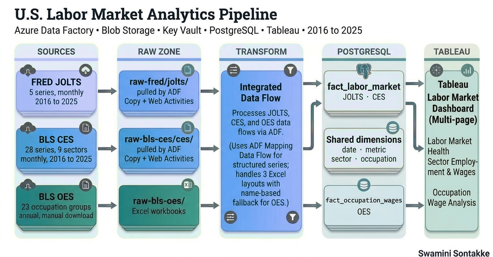

# U.S. Labor Market Analytics Pipeline

An end-to-end, cloud-native data engineering portfolio project: three public labor
market data sources ingested and transformed through Azure Data Factory into a
star schema on PostgreSQL, visualized through three Tableau dashboards.

**Stack:** Azure Data Factory (Copy Activities, Web Activities, Mapping Data Flows)
&middot; PostgreSQL Flexible Server &middot; Tableau Desktop
## Architecture

For the full write-up - motivation, architecture, challenges and how they were
resolved, data validation approach, limitations, and future enhancements - see
the project report included in this repository.

## Architecture

Two independent stages: **ingestion** pipelines land raw source data in Blob
Storage, and **transformation** pipelines (each wrapping a single Mapping Data
Flow) load it into a star schema in PostgreSQL.

| Pipeline | Pattern | Sink |
|---|---|---|
| `pl_ingest_fred_jolts` | Web Activity (Key Vault) -> ForEach 5 series -> Copy Activity | Blob: `raw-fred/jolts/` |
| `pl_ingest_bls_ces` | Web Activity (Key Vault) -> Web Activity (POST, 28 series) -> Web Activity (PUT to Blob) | Blob: `raw-bls-ces/ces/` |
| *(OES ingestion)* | Manual download of BLS OES Excel workbooks | Blob: `raw-bls-oes/` |
| `pl_transform_fred_jolts` | ForEach 5 series -> Execute Data Flow `df_jolts_to_pg` | `fact_labor_market` |
| `pl_transform_bls_ces` | Execute Data Flow `df_ces_to_pg` | `fact_labor_market` |
| `pl_transform_bls_oes` | ForEach 10 years -> Execute Data Flow `df_oes_to_pg` | `fact_occupation_wages` |

## Data model

Star schema with two fact tables (`fact_labor_market`, `fact_occupation_wages`)
sharing `dim_date` and `dim_metric`, each also joining a dedicated dimension
(`dim_sector` / `dim_occupation`). Full ER diagram and DDL are in the report
and support files.

## Data sources

| Source | Description | Granularity | Coverage |
|---|---|---|---|
| FRED JOLTS | Job openings, hires, separations, quits, layoffs (5 series) | Monthly, national | 2016-2025 |
| BLS CES | Employment, hourly earnings, weekly hours across 9 supersectors (28 series) | Monthly, by sector | 2016-2025 |
| BLS OES | Employment, mean hourly/annual wage across 23 major occupation groups | Annual, by occupation | 2016-2025 |

## Dashboards

Three Tableau dashboards, each built on its own extract: 

- **Labor Market Health** - job openings/hires/separations, quit vs. layoff rate, labor market tightness
- **Sector Employment & Wages** - employment by sector, hourly earnings, weekly hours
- **Occupation Wage Analysis** - top-paying occupations, employment vs. wage, wage growth 2016-2025

**[View the interactive dashboards on Tableau Public]((https://public.tableau.com/views/US_Labour_Market_Analysis/SectorEmploymentWages))**

## Key Findings

1. **The labor market has cooled from its 2022 peak.** Job openings peaked at roughly 12M in early 2022, about double the pre-COVID level, and have since fallen to roughly 6.5M. The gap between openings and hires has largely closed, which points to a much less tight labor market than at the post-COVID peak.

2. **Pay and hours vary sharply by sector.** In 2025, Information had the highest average hourly earnings ($52.59), about 70% above Trade, Transportation & Utilities ($30.97). Mining & Logging worked the longest weeks (about 45 hours), while Education & Health Services worked the shortest (about 32).

3. **Lower-paid occupations saw the fastest wage growth from 2016 to 2025.** Food Preparation (+55.8%) and Personal Care (+54.9%) grew fastest, while Management (+23.1%) grew slowest. Management still averaged the highest pay (about $128.8K across 2016-2025), so the gap is narrowing in percentage terms but remains large in absolute dollars.
4. **COVID-19 caused a sharp but brief shock.** In April 2020, total separations spiked to roughly 16M, about 3x the pre-pandemic level of around 5-6M, driven by a layoff surge to roughly 13M. Quits dropped to under 2M, and hires fell to about 4M before rebounding to around 8M within months. Sector employment shows the same pattern, with a sharp one-month drop in 2020 and recovery to pre-COVID levels by 2022 in most sectors.

## Notable engineering challenges

Full detail in the project report, briefly:

- **Multi-generational schema drift** - BLS OES changed its Excel column layout
  twice across 2016-2025 (three distinct formats). Resolved with a tiered
  `byName()` fallback in `df_oes_to_pg` rather than three separate pipelines.
- **Native Unpivot type-validation bug** - replaced with an explicit
  Derived-Column-per-metric + Union (`byName`) pattern.
- Silent date-type mismatches in ADF/PostgreSQL lookups, API key timing, Blob
  soft-delete interference, and a column-name collision between fact and
  dimension metadata - all documented with root cause and resolution.

## Notes

- ADF linked service files reference Azure Key Vault for all credentials
  (`AzureKeyVaultSecret`) - no secrets are stored in this repository.

  ## Known limitations

- **OES ingestion is manual.** FRED and CES are pulled by Azure Data Factory pipelines, but I download the annual BLS OES Excel workbooks by hand and place them in the `raw-bls-oes/` Blob folder as the API for OES was not functional when the project was built.
- **Portfolio scale.** The database runs on a Burstable B1ms PostgreSQL Flexible Server. That is plenty for these datasets, but it isn't sized for production load.

The project report (`Labor_Market_Analytics_Project_Report.pdf`) covers the validation approach and the production considerations in more detail.
